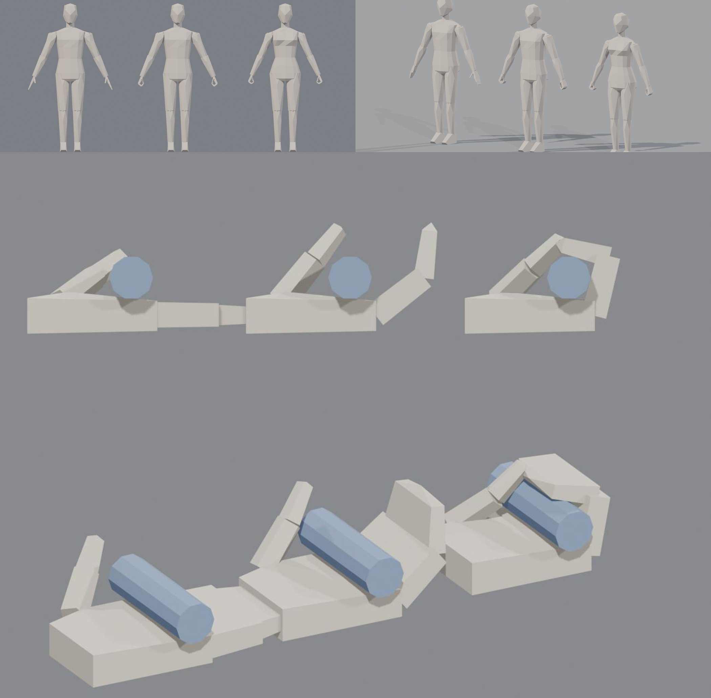

# LPM — Faceless Low-Poly Humanoid (origami style)

Procedural **faceless low-poly human base mesh** (male / female) in pure Python, built for games, Blender and three.js.
Flat planar facets, a continuous lofted torso, separate convex limbs, detachable head/hands/feet with named **sockets**,
and **grippable hands** (mitten + thumb, 5 hinged parts) controlled by one parameter.



## Quick start
```bash
pip install numpy scipy trimesh
python3 lpm.py --out out/male --gioi nam            # open hands
python3 lpm.py --out out/female --gioi nu --co 1    # fist around a Ø32 mm grip
blender -b -P xem_lpm.py -- out/sheet.png out/male.glb out/female.glb   # 4-view render
```
Every build writes `.glb` (Y-up glTF, one node per body part + `SOCKET_*` empties), `.obj`, `.json` (sockets, hinge axes),
then **auto-runs `soi_lpm.py`** — 15 measured gates; the build exits **1** if any fails.

## What the gates check (measured on the exported file)
watertight parts · triangle budget · height & feet on ground · body volume · continuous torso (no stacked boxes) ·
part/socket contract · L/R symmetry · waist taper · faceless head density · slight buttocks · forehead profile ·
no «skirt hem» at the pelvis · hand grips a Ø32 mm cylinder (≥75 % wrap, ≤1.5 mm penetration).

## Design rules (learned the hard way — see `SKILL.md` §9 upgrade log)
- Change body shape by editing the **section tables** (`THAN`), never by inserting blocks.
- Keep facet density uniform; this skill is deliberately **faceless** (detailed faces were tried and rejected; code kept in `history/`).
- Hand curl angles come from a **grid search** (`SKILL.md`), not from eyeballing.
- A gate that passes while the render looks wrong is a broken gate — measure what the viewer sees.

Docs are in Vietnamese (`SKILL.md`); code identifiers are Vietnamese (e.g. `than` = torso, `tay` = hand, `co` = curl).

## Credits
v1 by Antigravity & Hermes · v2 rewritten by Claude (Anthropic) with Hung Pham, Oct 2026. MIT licensed.
