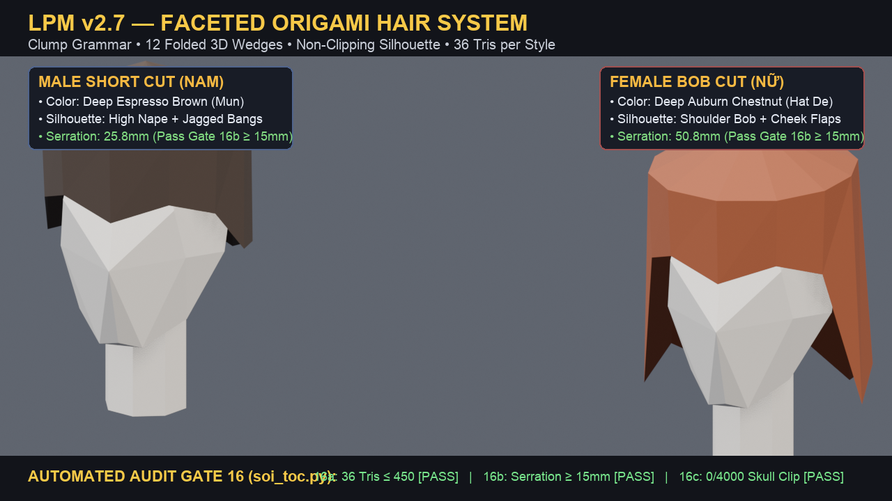

# LPM — Faceless Low-Poly Humanoid (origami style)

Procedural **faceless low-poly human base mesh** (male / female) in pure Python, built for games, Blender, Godot 4, and three.js.
Flat planar facets, a continuous lofted torso, separate convex limbs, detachable head/hands/feet with named **sockets**,
**grippable hands** (mitten + thumb, 5 hinged parts) controlled by one parameter, and **v2.7 Origami Hair Clump Grammar** with automated silhouette gating.




## Quick start
```bash
pip install numpy scipy trimesh
python3 lpm.py --out out/male --gioi nam            # open hands
python3 lpm.py --out out/female --gioi nu --co 1    # fist around a Ø32 mm grip
python3 toc_origami.py                              # generates male & female origami hair clumps
python3 soi_toc.py samples/hair_origami_nam.glb     # Gate ⑯ silhouette audit
blender -b -P xem_lpm.py -- out/sheet.png out/male.glb out/female.glb   # 4-view render
```
Every build writes `.glb` (Y-up glTF, one node per body part + `SOCKET_*` empties), `.obj`, `.json` (sockets, hinge axes),
then **auto-runs `soi_lpm.py`** — 15 measured gates (+ Gate ⑯ for hair); the build exits **1** if any fails.

## What the gates check (measured on the exported file)
watertight parts · triangle budget · height & feet on ground · body volume · continuous torso (no stacked boxes) ·
part/socket contract · L/R symmetry · waist taper · faceless head density · slight buttocks · forehead profile ·
no «skirt hem» at the pelvis · hand grips a Ø32 mm cylinder (≥75 % wrap, ≤1.5 mm penetration) ·
**Gate ⑯ Origami Hair Clump Grammar**: budget ≤450 tris, silhouette toothiness ≥15 mm, zero skull penetration (0/4000 samples).

## Sub-Skills & Ecosystem Architecture
This repository contains two first-class integrated sub-skills located under `skills/`:
1. [`skills/humanoid-replaceable-assets`](skills/humanoid-replaceable-assets/SKILL.md):
   - Modular layer assets attaching via LPM sockets (`SOCKET_dau`, `SOCKET_cam_*`, `SOCKET_ban_chan_*`, `SOCKET_lung`).
   - Origami hair clump grammar (`toc_origami.py`), early settler outfits (`toc_do.py`), and low-poly hand tools (`cong_cu.py`).
2. [`skills/procedural-low-poly-world`](skills/procedural-low-poly-world/SKILL.md):
   - Procedural 3D low-poly world building, island generation, terrain dioramas, and stylized biome assets for Three.js & Godot 4.

## Bi-Directional Pointer: GameDev Companion Workspace
This repository works in close harmony with the companion local workspace:
- **Local Path**: [`../GameDev/`](../GameDev/) (`/Users/hungpham/projects/GameDev`)
- **Role & Boundary**:
  - `lpm-faceless-humanoid` is the **Canonical Humanoid Base Mesh & Layer Contract Authority** (base bodies, sockets, origami hair, validation gates).
  - `GameDev` is the **Game Asset Factory, Animation Testbed & Procedural World Engine**:
    - **Engine Primitives**: `lpms/lpms_helpers.py` providing `khoi()`, `khoi_meo()`, `quet()`, `dun()`, `la_gap()`.
    - **Unified Color Theme**: `theme_mau.py` (sRGB color mapping across all assets).
    - **Asset Store**: `lpms_store/` containing 34 production-ready low-poly props, furniture, and environmental pieces.
    - **Starter Packs**: `assets/aoe_starter_pack/` including the approved Mountain & Waterfall Pack Master v6.0, Starter 4-Square Storage, and Stylized Oak Tree.
    - **Animation Testbed**: `anim_settler/` (motion clips retargeted onto the LPM rig, Godot 4 export pipeline).

## Design rules (learned the hard way — see `SKILL.md` §9 upgrade log)
- Change body shape by editing the **section tables** (`THAN`), never by inserting blocks.
- Keep facet density uniform; this skill is deliberately **faceless** (detailed faces were tried and rejected; code kept in `history/`).
- Hand curl angles come from a **grid search** (`SKILL.md`), not from eyeballing.
- Hair clumps must follow the **Origami Clump Grammar** with automated silhouette gates (`soi_toc.py`), never smooth helmet shells.
- A gate that passes while the render looks wrong is a broken gate — measure what the viewer sees.

Docs are in Vietnamese (`SKILL.md`); code identifiers are Vietnamese (e.g. `than` = torso, `tay` = hand, `co` = curl).

## Credits
v1 by Antigravity & Hermes · v2 rewritten by Claude (Anthropic) with Hung Pham, Oct 2026. MIT licensed.
